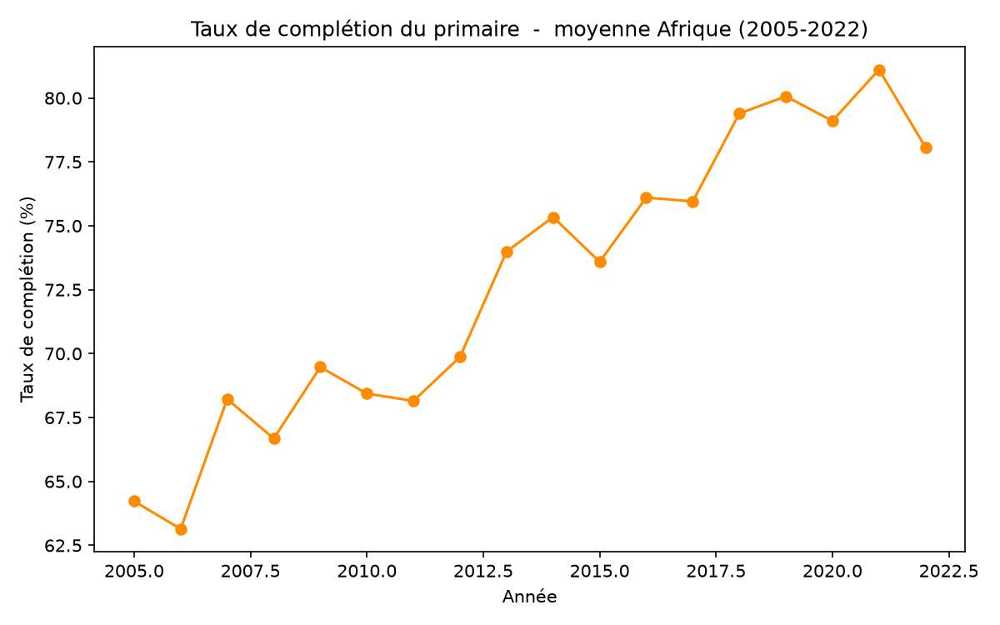
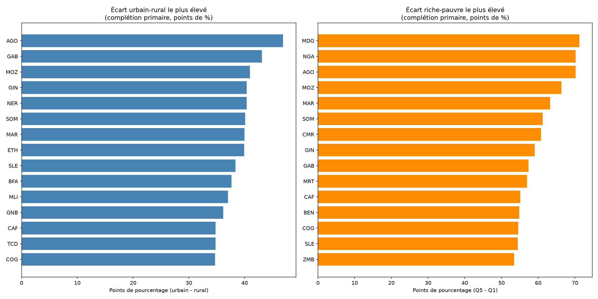
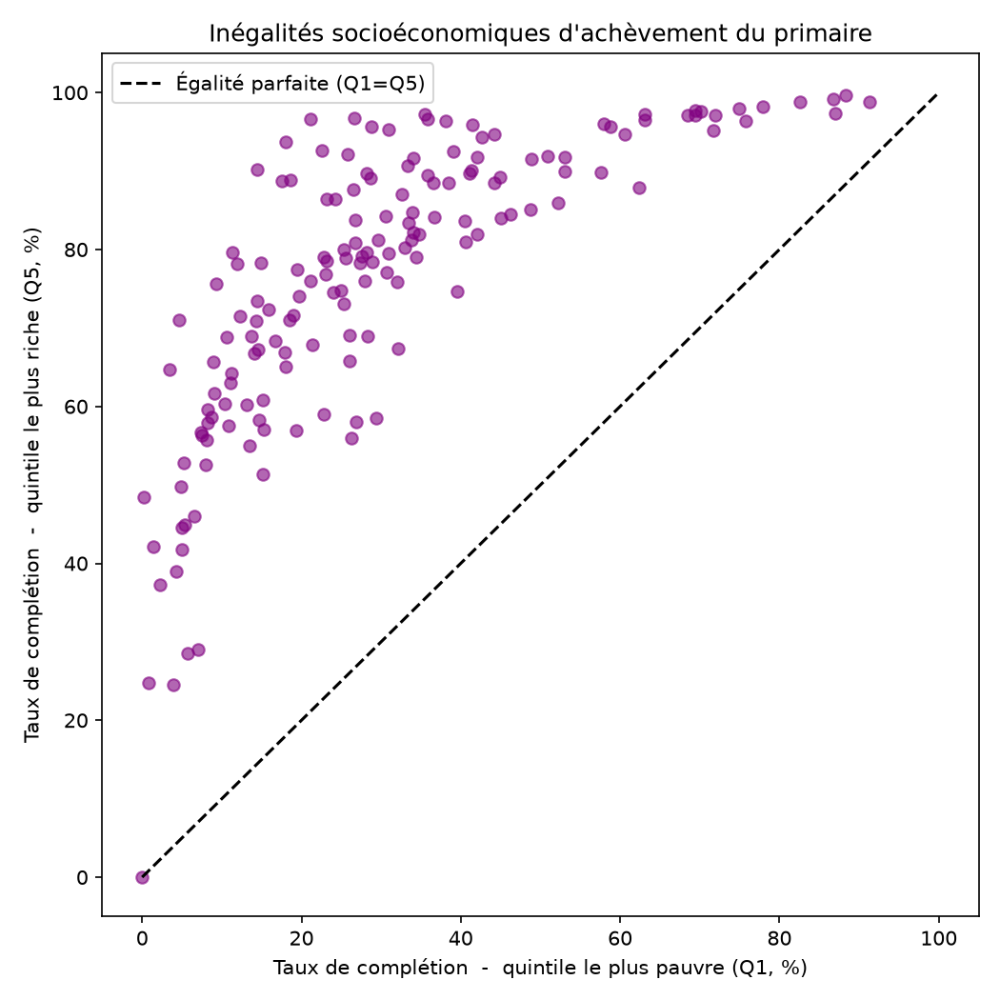
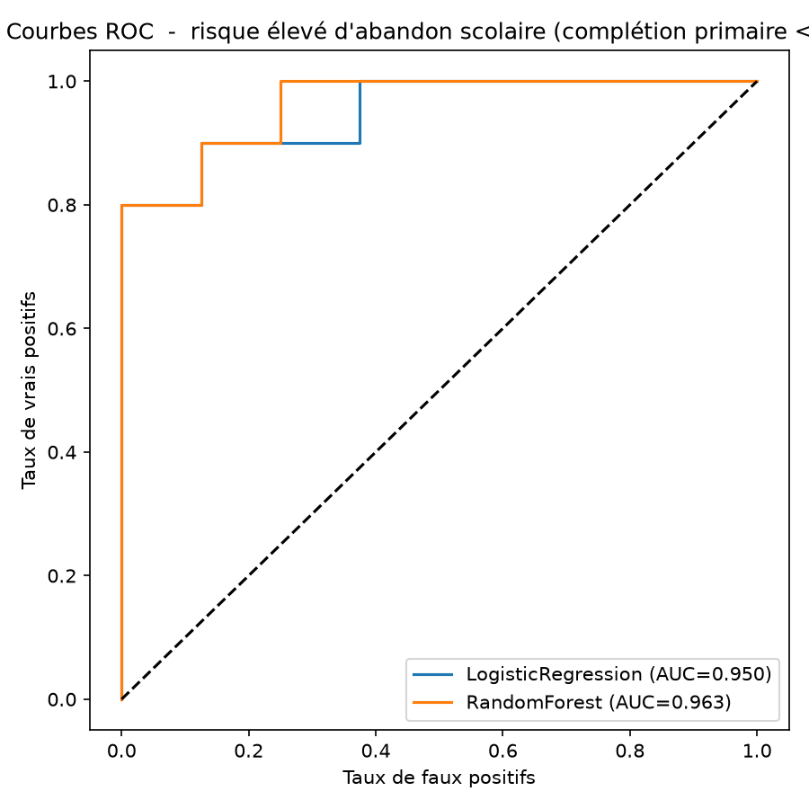
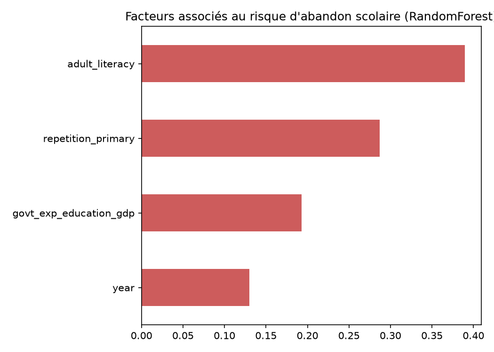
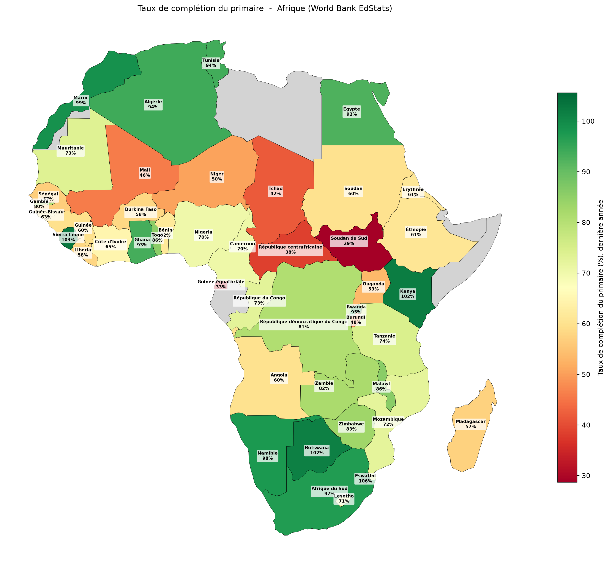

# Éducation en Afrique : ce que révèlent 17 ans de données sur les inégalités d'accès

*Média Marcel Bakayoko  -  Expert géomatique / données géospatiales & agricoles / GeoAI / Suivi-Évaluation*

## Le problème

L'accès à l'éducation primaire a considérablement progressé en Afrique depuis les années 2000,
mais les moyennes continentales masquent des écarts considérables  -  entre pays, entre milieux
urbain et rural, et entre ménages riches et pauvres au sein d'un même pays. Ce projet exploite les
données ouvertes de la Banque Mondiale et de l'UNESCO pour quantifier précisément ces écarts et
identifier les facteurs associés au risque d'abandon scolaire.

## Les données

53 pays africains, 2005-2022, 861 observations pays-année, construites à partir de 11 indicateurs :
taux de complétion primaire/secondaire, enfants non scolarisés, redoublement, dépenses publiques
d'éducation, alphabétisation, et  -  point central de l'analyse  -  la complétion primaire désagrégée
par milieu de résidence (rural/urbain) et par quintile de richesse du ménage.

## Tendance continentale

La complétion moyenne du primaire progresse globalement sur la période, mais avec des paliers et
des reculs ponctuels selon les années et les pays disponibles dans l'échantillon à chaque période.

## Des inégalités socioéconomiques considérables

L'écart entre le quintile le plus riche et le quintile le plus pauvre en matière d'achèvement du
primaire atteint des niveaux considérables dans plusieurs pays :
- **Madagascar** : 71 points de pourcentage
- **Nigeria** : 70 points
- **Angola** : 70 points
- **Mozambique** : 66 points
- **Maroc** : 63 points

À l'opposé, l'Afrique du Sud (7 points), l'Égypte (10 points), la Tunisie (11 points) et l'Algérie
(12 points) affichent des écarts beaucoup plus faibles  -  ces pays ont largement généralisé l'accès
au primaire indépendamment du niveau de richesse des ménages. L'écart urbain-rural suit un schéma
similaire mais moins marqué (jusqu'à 47 points en Angola, contre moins de 4 points en Algérie).

Le nuage de points quintile riche vs quintile pauvre illustre bien ce phénomène : de nombreux pays
se situent loin de la diagonale d'égalité parfaite, preuve que l'accès à l'éducation primaire reste
fortement conditionné par le statut socioéconomique du ménage dans une large partie du continent.

## Peut-on prédire le risque d'abandon scolaire ?

Un modèle Random Forest atteint une AUC de 0,96 pour prédire un risque élevé d'abandon (complétion
primaire < 70%) à partir du taux de redoublement, des dépenses publiques d'éducation et de
l'alphabétisation adulte. **Cependant, cet échantillon ne compte que 69 observations** où toutes
les variables sont disponibles simultanément  -  un résultat à interpréter avec prudence (voir
Limites), même si la direction des effets est cohérente avec la littérature.

L'alphabétisation adulte est le facteur le plus discriminant, suivie du taux de redoublement et des
dépenses publiques d'éducation  -  un schéma cohérent : le niveau d'éducation des parents (proxy
indirect de l'alphabétisation adulte nationale) et l'efficacité interne du système scolaire
(redoublement) sont des déterminants bien documentés de la persistance scolaire.

## Cartographie des disparités territoriales

La carte révèle un gradient géographique marqué : l'Afrique du Nord (Maroc 99%, Algérie 94%,
Tunisie 94%, Égypte 92%) et l'Afrique australe (Namibie 98%, Afrique du Sud 97%, Botswana >100%)
affichent des taux élevés, tandis qu'une bande sahélienne et centrale concentre les pays les plus
en difficulté : Soudan du Sud (29%), Guinée équatoriale (33%), République Centrafricaine (38%),
Tchad (42%), Mali (46%).

> Note technique : certains taux dépassent 100% dans les données sources  -  cela reflète la méthode
> de calcul de l'indicateur (nombre d'élèves achevant le dernier grade du primaire rapporté à la
> population d'âge théorique correspondant), qui peut dépasser 100% en présence d'entrées tardives
> ou de redoublements comptabilisés dans le numérateur.

## Recommandations

1. **Cibler les politiques de gratuité et de bourses sur les quintiles les plus pauvres** dans les
   pays où l'écart riche-pauvre dépasse 50 points (Madagascar, Nigeria, Angola, Mozambique) : l'accès
   universel au primaire y reste conditionné par la capacité financière du ménage.
2. **Prioriser le Sahel et l'Afrique centrale** (Soudan du Sud, Centrafrique, Tchad, Mali, Guinée
   équatoriale) pour les investissements en infrastructures scolaires et en formation d'enseignants.
3. **Travailler simultanément sur l'alphabétisation adulte et la réduction du redoublement** :
   ces deux facteurs ressortent comme les plus discriminants, suggérant des interventions
   combinant programmes d'alphabétisation des parents et réforme pédagogique pour réduire
   l'échec scolaire précoce.
4. **S'inspirer des pays à faible inégalité** (Afrique du Sud, Égypte, Tunisie, Algérie) pour
   identifier les leviers de politiques publiques ayant permis de réduire l'écart riche-pauvre
   à moins de 15 points.

## Limites

- L'échantillon de classification (69 observations) est petit  -  la variance en validation croisée
  (± 0,16 d'AUC) indique une instabilité du modèle qui appelle la prudence dans l'interprétation
  des scores de performance bruts. Les facteurs identifiés (alphabétisation, redoublement) restent
  néanmoins cohérents avec un vaste corpus de recherche en économie de l'éducation.
- Les données désagrégées (rural/urbain, quintile de richesse) ne sont disponibles que pour un
  sous-ensemble de pays et d'années  -  les comparaisons entre pays portent parfois sur des années
  différentes (toujours la plus récente disponible), introduisant un biais temporel potentiel.
- Les indicateurs utilisés sont agrégés au niveau national  -  une analyse infranationale (par
  région ou district) serait nécessaire pour un ciblage opérationnel précis, dans l'esprit du
  projet complémentaire sur les données démographiques EDS/DHS.

---
*Source : World Bank Open Data (EdStats) / UNESCO Institute for Statistics  -  CC BY 4.0.*
